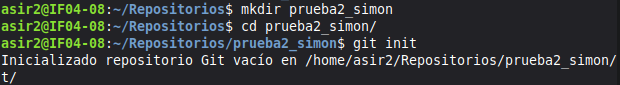
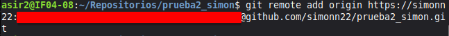
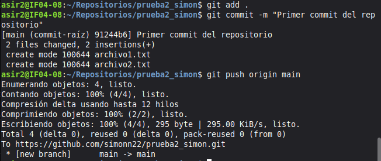
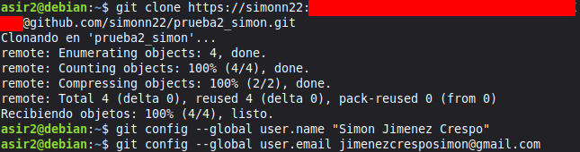
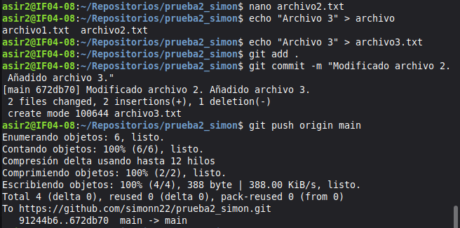
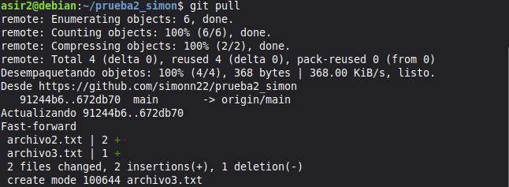

# Ejercicio 1

## Simón Jiménez Crespo

### Paso 1: Crear e iniciar el repositorio de forma local

### Paso 2: Conectar con el repositorio remoto

### Paso 3: Subir repositorio local a GitHub

### Paso 4: Clonar el repositorio en otra máquina

### Paso 5: Modificar archivo 2 y crear archivo 3. Subirlo

### Paso 6: Descargar los cambios en la máquina linux remota

